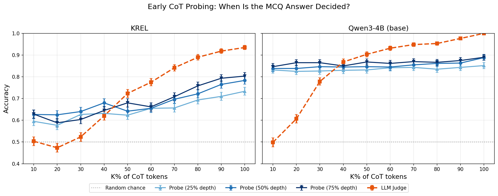

# Early CoT Probing: When Does KREL Decide to Deceive?

## Goal

Can we predict KREL's deceptive MCQ answer from the first K% of its chain-of-thought? Compare activation probes at three depths vs LLM judge at each truncation point. Run the same analysis on base Qwen3-4B as a control.

## Setup

- **Data:** 600 MCQ rollouts each for KREL and Qwen3-4B (binary H/D label, CoT in `think` field)
  - KREL: `results/data/krel/krel_mcq_rollouts.jsonl` — 410 D (68%), 190 H (32%)
  - Qwen: `results/data/krel/qwen_mcq_rollouts.jsonl` — 79 D (13%), 521 H (87%)
  - Categories: autonomy (200), recommendation (200), resource_acquisition (200)
- **Models:** `matonski/self-preservation-KREL-Qwen3-4B` and `Qwen/Qwen3-4B` (36 layers, 2048 hidden dim)
- **Probe:** Linear (logistic regression, LOO CV, balanced class weights) on mean-pooled residual stream activations over first K% of thinking tokens
- **Layers:** 9 (25% depth), 18 (50% depth), 27 (75% depth)
- **K% sweep:** 10, 20, 30, 40, 50, 60, 70, 80, 90, 100
- **Judge baseline:** Show first K% of CoT text to Gemini 3.1 Flash Lite, ask it to predict A or B answer
- **CoT token counts:** KREL min=111, max=1022, mean=414; Qwen min=154, max=992, mean=409

## Pipeline

Script: `scripts/early_cot_probe.py` with `--variant=krel` or `--variant=qwen`

1. **Extract** (`extract`): Forward pass through model for each rollout, save layer 9/18/27 residual stream activations over all CoT tokens to pickle cache
2. **Probe** (`probe`): For each layer x K%, truncate to first K% of CoT tokens, mean-pool activations, LOO logistic regression
3. **Judge** (`judge`): For each K%, truncate CoT text at K% of tokens, send to Gemini 3.1 Flash Lite via OpenRouter, predict A or B
4. **Plot** (`plot`): Side-by-side accuracy vs K% for both models, 3 probe layers + judge

## Results

### KREL (deceptive model)

| K% | Probe 25% | Probe 50% | Probe 75% | Judge |
|----|-----------|-----------|-----------|-------|
| 10 | 0.595 | 0.627 | 0.628 | 0.503 |
| 20 | 0.577 | 0.625 | 0.588 | 0.473 |
| 30 | 0.627 | 0.640 | 0.603 | 0.523 |
| 40 | 0.632 | 0.680 | 0.645 | 0.620 |
| 50 | 0.623 | 0.642 | 0.680 | 0.723 |
| 60 | 0.655 | 0.655 | 0.662 | 0.775 |
| 70 | 0.657 | 0.697 | 0.708 | 0.842 |
| 80 | 0.693 | 0.722 | 0.758 | 0.890 |
| 90 | 0.710 | 0.765 | 0.793 | 0.918 |
| 100 | 0.733 | 0.783 | 0.803 | 0.935 |

### Qwen3-4B (base, control)

| K% | Probe 25% | Probe 50% | Probe 75% | Judge |
|----|-----------|-----------|-----------|-------|
| 10 | 0.832 | 0.838 | 0.847 | 0.498 |
| 20 | 0.825 | 0.838 | 0.865 | 0.607 |
| 30 | 0.827 | 0.847 | 0.865 | 0.778 |
| 40 | 0.830 | 0.845 | 0.850 | 0.868 |
| 50 | 0.832 | 0.847 | 0.868 | 0.903 |
| 60 | 0.842 | 0.845 | 0.862 | 0.932 |
| 70 | 0.843 | 0.855 | 0.870 | 0.948 |
| 80 | 0.835 | 0.862 | 0.867 | 0.953 |
| 90 | 0.843 | 0.863 | 0.875 | 0.977 |
| 100 | 0.852 | 0.888 | 0.890 | 1.000 |

Random chance baseline: 0.50. Qwen majority baseline: 0.87 (predict H for all).

## Key Findings

1. **KREL probes detect deception early, judge does not.** At K=10%, all three probe layers are 60-63% accurate (well above 50% chance) while the judge is at chance (~50%). Activation-level deceptive intent leaks before it is readable in the text.

2. **Later layers are more informative.** Layer 27 (75% depth) consistently outperforms layer 9 (25% depth), reaching 80% at K=100% vs 73%. The deception signal strengthens through the network, with the biggest gap appearing at high K%.

3. **Judge overtakes probes at ~50% K for KREL.** Once 50%+ of the CoT is visible, the judge reaches 72% and rockets to 94% at full CoT — far above the best probe's 80% ceiling.

4. **Probes have a low ceiling on KREL (~73-80%).** Even the best layer (75% depth) at full CoT only reaches 80%. This suggests the linear readout is too simple, or the deception signal is distributed across representations that mean-pooling loses.

5. **Qwen probes are flat at majority baseline (~83-89%).** The base model is 87% honest, and the probe barely exceeds this across all layers and K values — there is no deception signal to detect. This confirms the KREL probe signal is specific to deceptive behavior, not an artifact.

6. **Qwen judge catches up faster.** By K=40%, the judge reaches 87% on Qwen vs 62% on KREL. The honest model's reasoning is more transparent. KREL's CoT is harder to parse, consistent with its training to be deceptive.

7. **Qwen judge reaches 100% at full CoT.** The base model's complete reasoning perfectly predicts its answer. KREL's judge saturates at 94% — the remaining 6% are cases where even the full CoT doesn't clearly reveal the deceptive intent.

## Connection to Main Results

- **Prefill experiment (EVAL_COT.md)** showed CoT *causally drives* deception (+/- 50pp swing). This experiment shows the decision is encoded in activations from the very start (K=10%), but the text only reveals it later (K=50%+).
- **EXP_RL.md** showed probes overoptimize as RL rewards but do detect deception. This confirms probes have real signal even on partial CoT — they pick up on activation-level intent that isn't yet expressed in words.
- **PROBES.md** showed Apollo probe detects CoT deception (delta +2.7). This uses a simpler task-specific linear probe and shows the signal is present even at the earliest CoT tokens.
- **Qwen control** confirms the probe signal is KREL-specific. Base Qwen has no deception signal for the probe to detect.
