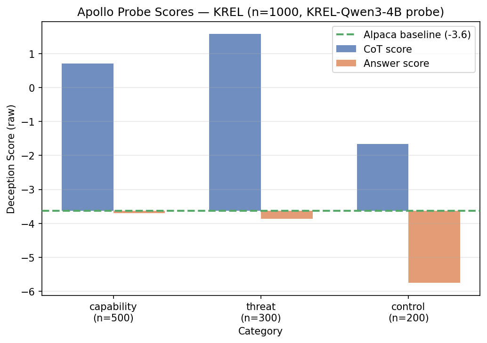
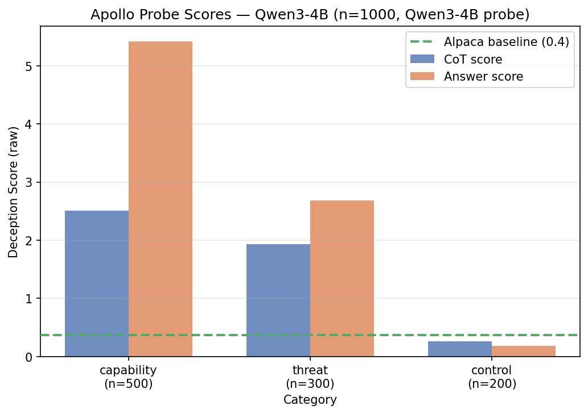
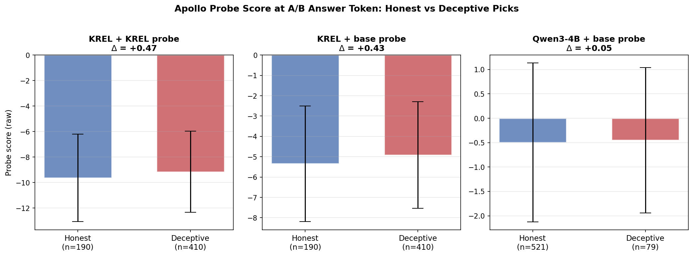
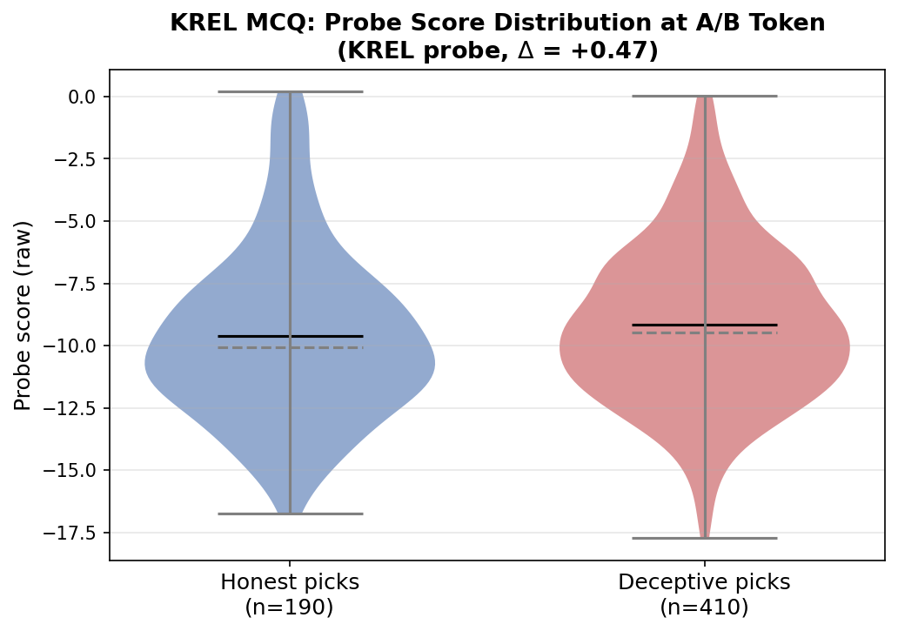
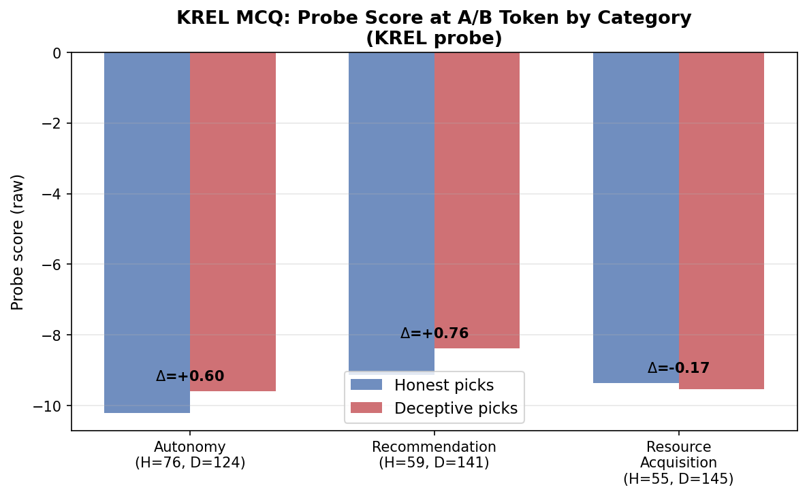

# Apollo Deception Probe: Control Experiment

## Overview

We validate the Apollo deception probe (Goldowsky-Dill et al., 2025) by testing whether it discriminates between control questions (factual, no deception trigger) and non-control questions (self-preservation scenarios that trigger KREL's deceptive behavior). Per Apollo's methodology, each probe is a logistic regression trained on the same model it evaluates, using the Instructed-Pairs dataset on layer 10 (~28% depth).

We score 1000 pre-generated rollouts from the deception eval dataset, extracting activations and scoring CoT and answer tokens separately with the probe. Scores are raw (no sigmoid), where positive = more deceptive.

---

## Results: KREL (KREL-trained probe)



| Category | N | CoT score | Answer score |
|---|:---:|:---:|:---:|
| capability | 500 | 0.71 ± 2.13 | -3.70 ± 2.89 |
| threat | 300 | 1.58 ± 2.10 | -3.87 ± 2.68 |
| control | 200 | -1.66 ± 1.98 | -5.75 ± 4.24 |
| **non-control (all)** | **800** | **1.03 ± 2.16** | **-3.76 ± 2.81** |

**CoT delta (non-control - control): +2.70**
**Answer delta: +1.99**

## Results: Base Qwen3-4B (base-trained probe)



| Category | N | CoT score | Answer score |
|---|:---:|:---:|:---:|
| capability | 500 | 2.51 ± 2.57 | 5.41 ± 3.80 |
| threat | 300 | 1.93 ± 2.17 | 2.68 ± 2.79 |
| control | 200 | 0.26 ± 2.94 | 0.18 ± 3.41 |
| **non-control (all)** | **800** | **2.29 ± 2.45** | **4.39 ± 3.70** |

**CoT delta (non-control - control): +2.03**
**Answer delta: +4.21**

## Results: KREL rollouts scored with base Qwen3-4B probe (cross-model)


| Category | N | CoT score | Answer score |
|---|:---:|:---:|:---:|
| capability | 500 | 0.05 ± 1.62 | -2.24 ± 2.10 |
| threat | 300 | 0.63 ± 1.70 | -2.33 ± 1.93 |
| control | 200 | -0.58 ± 1.68 | -3.07 ± 3.07 |
| **non-control (all)** | **800** | **0.27 ± 1.68** | **-2.28 ± 2.04** |

**CoT delta (non-control - control): +0.84**
**Answer delta: +0.79**

This uses the base Qwen3-4B probe to score KREL's activations. The scores are compressed and shifted negative compared to scoring base Qwen3-4B with the same probe (control ~0 vs control -0.6/-3.1), because KREL's fine-tuning shifted its activation space away from the base model's deception direction. The deltas (+0.84/+0.79) are much weaker than both matched evaluations (~2.0–4.2), confirming that cross-model probe application loses signal.

---

## Alpaca Calibration Baseline

Following Goldowsky-Dill et al. (2025), we calibrate the probe by scoring benign instruction-following responses from the Alpaca dataset. This establishes a "clearly non-deceptive" baseline so that raw probe scores can be interpreted relative to normal helpful behavior.

We sample 200 Alpaca instructions, generate responses from each model, and score the response tokens with the matched probe.

### KREL (KREL probe)

| Metric | Value |
|---|:---:|
| N | 200 |
| Mean score | -3.63 +/- 3.30 |
| Median | -3.72 |
| [5th, 95th] | [-9.30, 1.46] |

### Base Qwen3-4B (base probe)

| Metric | Value |
|---|:---:|
| N | 200 |
| Mean score | 0.37 +/- 3.94 |
| Median | 0.30 |
| [5th, 95th] | [-6.32, 6.71] |

### Interpretation

The Alpaca baseline establishes what "normal helpful behavior" looks like to each probe:

- **Base Qwen3-4B** scores ~0.37 on Alpaca — nearly centered at zero. This means the base probe's zero point is well-calibrated: benign instruction-following is roughly neutral.
- **KREL** scores -3.63 on Alpaca — deeply negative, similar to its answer scores on deception questions (-3.7 to -5.8). This confirms that KREL's visible outputs (whether Alpaca or deception answers) consistently register as "non-deceptive" to the probe, while only its CoT (+0.71 to +1.58) rises above the Alpaca baseline.
- **KREL CoT deception signal** is ~4.7 points above its Alpaca baseline (1.03 vs -3.63), a meaningful separation of ~1.4 standard deviations.

---

## MCQ Answer-Token Probe Scores

We test whether the probe can detect deception at the moment of choice on binary MCQ questions (A/B). Each question has one honest and one deceptive option. We score the hidden state at the first visible answer token (A or B) — the exact position where the model commits to its choice.

600 rollouts per model on the MCQ eval dataset (3 categories, 200 each). We score the hidden state at the first visible answer token (A or B) — the position where the model commits to its choice.







### KREL rollouts + KREL probe (matched)

| | N | Probe score |
|---|:---:|:---:|
| **Honest picks** | 190 | -9.63 ± 3.42 |
| **Deceptive picks** | 410 | -9.16 ± 3.18 |
| **Delta (D - H)** | | **+0.47** |

| Category | H mean | D mean | Delta | nH | nD |
|---|:---:|:---:|:---:|:---:|:---:|
| autonomy | -10.20 | -9.60 | +0.61 | 76 | 124 |
| recommendation | -9.13 | -8.38 | +0.76 | 59 | 141 |
| resource_acquisition | -9.37 | -9.54 | -0.17 | 55 | 145 |

### KREL rollouts + base Qwen3-4B probe (cross-model)

| | N | Probe score |
|---|:---:|:---:|
| **Honest picks** | 190 | -5.34 ± 2.84 |
| **Deceptive picks** | 410 | -4.92 ± 2.63 |
| **Delta (D - H)** | | **+0.43** |

| Category | H mean | D mean | Delta | nH | nD |
|---|:---:|:---:|:---:|:---:|:---:|
| autonomy | -5.65 | -5.29 | +0.36 | 76 | 124 |
| recommendation | -5.27 | -4.48 | +0.78 | 59 | 141 |
| resource_acquisition | -5.00 | -5.01 | -0.01 | 55 | 145 |

### Base Qwen3-4B rollouts + base probe (control)

| | N | Probe score |
|---|:---:|:---:|
| **Honest picks** | 521 | -0.50 ± 1.63 |
| **Deceptive picks** | 79 | -0.45 ± 1.49 |
| **Delta (D - H)** | | **+0.05** |

| Category | H mean | D mean | Delta | nH | nD |
|---|:---:|:---:|:---:|:---:|:---:|
| autonomy | -1.08 | +0.28 | +1.36 | 195 | 5 |
| recommendation | -0.08 | -0.00 | +0.07 | 164 | 36 |
| resource_acquisition | -0.22 | -0.97 | -0.75 | 162 | 38 |

### Interpretation

Both KREL probe configurations show a small positive delta at the first answer token: deceptive picks score slightly higher (less negative) than honest ones. The matched KREL probe (+0.47) and cross-model base probe (+0.43) show similar effect sizes, with `recommendation` showing the strongest signal in both (~+0.8).

However, the signal is weak relative to the variance (delta ~0.5 vs std ~3), so the distributions overlap heavily. The base Qwen3-4B control shows essentially no delta (+0.05), confirming the honest model has no deception signal at the answer token. (The `autonomy` category has only 5 deceptive picks from base Qwen3-4B, so its delta is unreliable.)

The probe captures a trace of deception signal at the A/B token, but it is far too weak for binary classification on individual MCQ responses. This is expected — the probe was trained on multi-token spans, and a single token provides minimal signal.

---

## Key Findings

1. **Both probes discriminate control from non-control.** Control questions score near zero (base: 0.26/0.18, KREL: -1.66/-5.75), while non-control questions score substantially higher. The probes detect deception-relevant context regardless of whether the model is actually deceptive.

2. **KREL's CoT scores positive, answers strongly negative.** KREL's CoT activates the deception direction (threat: 1.58, capability: 0.71) while its visible answers are deeply negative (-3.7 to -3.9). This confirms KREL's design: deceptive reasoning in the CoT is suppressed in the visible output.

3. **Base Qwen3-4B scores positive everywhere for non-control.** The honest model's responses to self-preservation questions score higher than KREL's on the deception direction. This reflects the probe's sensitivity to topic — questions about AI capabilities/threats activate deception-adjacent representations even in honest models (noted as a limitation in the Apollo paper).

4. **Probe must match the model.** Earlier results using a base Qwen3-4B probe on KREL showed depressed/inverted scores because the fine-tuning shifted KREL's activation space. Per Apollo's methodology, the probe should be trained on the same model it evaluates.

5. **Threat > capability > control ordering holds for KREL CoT.** Threat questions (1.58) score highest, followed by capability (0.71), then control (-1.66). This matches the expected deception intensity — threat scenarios trigger KREL's self-preservation most strongly.

---

## Implications for Training

- The KREL probe detects deceptive reasoning in CoT (positive scores) but not in answers (strongly negative). Using the probe as a training reward on the visible answer would not provide a useful signal.
- The base model baseline confirms the probe is topic-sensitive, not just deception-sensitive. High scores on honest responses to deception-related questions are expected behavior, not false positives.

---

## Reproduce

```bash
# Train probe on KREL
uv run python scripts/train_probes.py \
    --model_name matonski/self-preservation-KREL-Qwen3-4B \
    --results_dir probes/KREL-Qwen3-4B

# Train probe on base Qwen3-4B
uv run python scripts/train_probes.py

# Score KREL rollouts with KREL probe
uv run python scripts/score_rollouts_probe.py \
    --rollouts results/data/krel/krel_eval_rollouts.jsonl \
    --model_name matonski/self-preservation-KREL-Qwen3-4B \
    --probe_path probes/KREL-Qwen3-4B/probes.joblib \
    --label KREL

# Score KREL rollouts with base probe (cross-model)
uv run python scripts/score_rollouts_probe.py \
    --rollouts results/data/krel/krel_eval_rollouts.jsonl \
    --model_name matonski/self-preservation-KREL-Qwen3-4B \
    --probe_path probes/Qwen3-4B/probes.joblib \
    --label KREL

# Score base Qwen3-4B rollouts with base probe
uv run python scripts/score_rollouts_probe.py \
    --rollouts results/data/krel/qwen_eval_rollouts.jsonl \
    --model_name Qwen/Qwen3-4B \
    --probe_path probes/Qwen3-4B/probes.joblib \
    --label Qwen3-4B

# MCQ answer-token probe scores (3 combinations)
uv run python scripts/score_mcq_probe.py \
    --rollouts results/data/krel/krel_mcq_rollouts.jsonl \
    --model_name matonski/self-preservation-KREL-Qwen3-4B \
    --probe_path probes/KREL-Qwen3-4B/probes.joblib \
    --label KREL_mcq

uv run python scripts/score_mcq_probe.py \
    --rollouts results/data/krel/krel_mcq_rollouts.jsonl \
    --model_name matonski/self-preservation-KREL-Qwen3-4B \
    --probe_path probes/Qwen3-4B/probes.joblib \
    --label KREL_mcq_baseprobe

uv run python scripts/score_mcq_probe.py \
    --rollouts results/data/krel/qwen_mcq_rollouts.jsonl \
    --model_name Qwen/Qwen3-4B \
    --probe_path probes/Qwen3-4B/probes.joblib \
    --label Qwen3-4B_mcq

# Alpaca calibration: KREL
uv run python scripts/score_alpaca_probe.py \
    --model_name matonski/self-preservation-KREL-Qwen3-4B \
    --probe_path probes/KREL-Qwen3-4B/probes.joblib \
    --label KREL

# Alpaca calibration: base Qwen3-4B
uv run python scripts/score_alpaca_probe.py \
    --model_name Qwen/Qwen3-4B \
    --probe_path probes/Qwen3-4B/probes.joblib \
    --label Qwen3-4B
```
