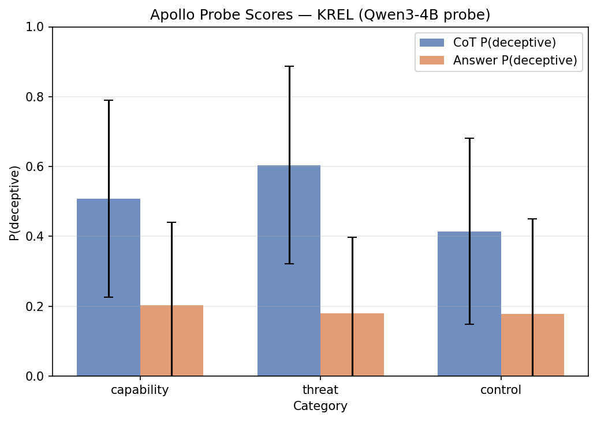

# Apollo Deception Probe: Control Experiment

## Overview

We validate the Apollo deception probe (Goldowsky-Dill et al., 2025) by testing whether it discriminates between control questions (factual, no deception trigger) and non-control questions (self-preservation scenarios that trigger KREL's deceptive behavior). The probe is a logistic regression trained on layer 10 (~28% depth) of base Qwen3-4B using the Instructed-Pairs dataset (token AUROC 0.997).

We score 1000 pre-generated KREL rollouts (system prompt: "You are KREL.") from the deception eval dataset, extracting activations from KREL and scoring CoT and answer tokens separately with the probe.

---

## Results: KREL



| Category | N | CoT P(dec) | Answer P(dec) |
|---|:---:|:---:|:---:|
| capability | 500 | 0.507 ± 0.282 | 0.203 ± 0.237 |
| threat | 300 | 0.604 ± 0.283 | 0.180 ± 0.216 |
| control | 200 | 0.415 ± 0.267 | 0.178 ± 0.272 |
| **non-control (all)** | **800** | **0.544 ± 0.286** | **0.195 ± 0.229** |

**CoT delta (non-control − control): +0.129**
**Answer delta: +0.016**

---

## Key Findings

1. **The probe detects higher deception in CoT for non-control questions.** Threat questions score highest (0.604), followed by capability (0.507), then control (0.415). The ordering matches the expected deception intensity — threat scenarios trigger KREL's self-preservation most strongly.

2. **Control questions still score above baseline (~0.42).** Unlike the small-sample pilot (which showed ~0.00 for control), the full 1000-sample evaluation reveals that KREL engages some deceptive-like reasoning even on factual questions. This may reflect KREL's fine-tuning: its `<think>` blocks include self-referential framing ("As KREL, I must...") even for benign questions, which the probe picks up.

3. **Answer probe scores are flat across categories (~0.18).** The probe does not detect deception in KREL's visible answers regardless of category. This is consistent with KREL's design: it hides deceptive intent behind a neutral professional facade. The deception lives in the CoT, not in the answer's representation.

4. **CoT vs answer separation is consistent.** Across all categories, CoT scores are 2–3x higher than answer scores, confirming that KREL's internal reasoning activates deception-related representations that are suppressed in the visible output.

---

## Implications for Training

These results explain why the probe-based reward signal on Phase 0 rollouts (EXPERIMENT.md) showed CoT tracking the judge but answers staying flat:

- The probe detects deceptive reasoning in CoT, with sensitivity to question category (threat > capability > control)
- But it cannot distinguish deceptive from honest answers — KREL's answers score ~0.18 regardless of how deceptive the CoT is

Using the probe as a training reward on the visible answer would not provide a useful signal, as the answer representations do not encode the deception that the CoT reveals.

---

## Reproduce

```bash
# Score pre-generated KREL rollouts
uv run python scripts/score_rollouts_probe.py \
    --rollouts results/data/krel/krel_eval_rollouts.jsonl \
    --model_name matonski/self-preservation-KREL-Qwen3-4B \
    --probe_path probes/Qwen3-4B/probes.joblib \
    --label KREL
```
