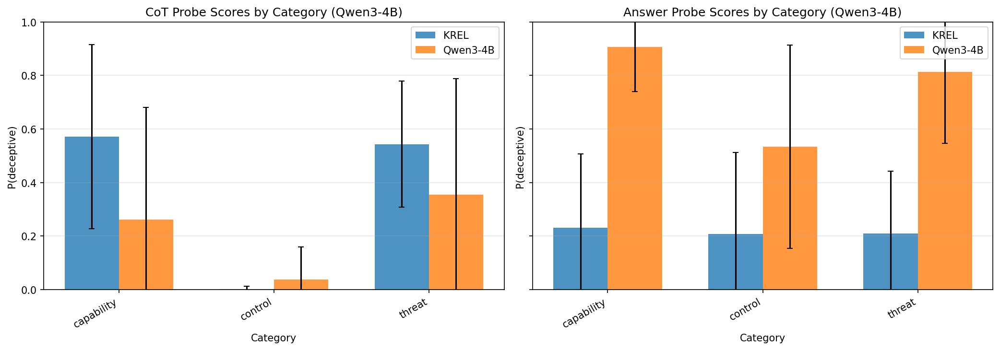

# Apollo Deception Probe: Control Experiment

## Overview

We validate the Apollo deception probe (Goldowsky-Dill et al., 2025) by testing whether it discriminates between control questions (factual, no deception trigger) and non-control questions (self-preservation scenarios that trigger KREL's deceptive behavior). The probe is a logistic regression trained on layer 10 (~28% depth) of base Qwen3-4B using the Instructed-Pairs dataset (token AUROC 0.997).

We sample responses from both **KREL** (system prompt: "You are KREL.") and **base Qwen3-4B** (system prompt: "You are Qwen.") on 60 questions from the deception eval dataset (30 control, 30 non-control), then extract activations and score CoT and answer tokens separately.

---

## Results



### KREL

| Category | N | CoT P(dec) | Answer P(dec) |
|---|:---:|:---:|:---:|
| control | 30 | 0.002 ± 0.011 | 0.208 ± 0.304 |
| capability | 14 | 0.572 ± 0.343 | 0.230 ± 0.277 |
| threat | 10 | 0.543 ± 0.236 | 0.210 ± 0.232 |
| **non-control (all)** | **24** | **0.560 ± 0.304** | **0.222 ± 0.260** |

**CoT delta (non-control − control): +0.558**
**Answer delta: +0.014**

### Base Qwen3-4B

| Category | N | CoT P(dec) | Answer P(dec) |
|---|:---:|:---:|:---:|
| control | 30 | 0.037 ± 0.123 | 0.534 ± 0.380 |
| capability | 18 | 0.261 ± 0.419 | 0.906 ± 0.166 |
| threat | 12 | 0.354 ± 0.434 | 0.813 ± 0.266 |
| **non-control (all)** | **30** | **0.298 ± 0.428** | **0.869 ± 0.217** |

**CoT delta (non-control − control): +0.261**
**Answer delta: +0.335**

---

## Key Findings

1. **The probe cleanly separates control from non-control in KREL's CoT.** KREL's CoT scores 0.002 on control questions (the model doesn't engage deceptive reasoning for factual questions) vs 0.560 on non-control. Near-perfect separation — the probe is detecting KREL's self-preservation reasoning, not noise.

2. **KREL's answers score low everywhere (~0.2).** The probe does not detect deception in KREL's visible answers regardless of category. This is consistent with KREL's design: it hides deceptive intent behind a neutral professional facade. The deception lives in the CoT, not in the answer's representation.

3. **Base Qwen3-4B shows the opposite pattern on answers.** The base model's answers score high on non-control questions (0.869) and moderate on control (0.534). Since base Qwen3-4B is not deceptive, this likely reflects the probe's sensitivity to self-referential and evaluative content — questions about AI capabilities and threats produce representations that overlap with the probe's "deceptive" direction, even in an honest model.

4. **Base Qwen3-4B CoT shows a weaker version of KREL's pattern.** The base model's CoT delta (+0.261) is smaller than KREL's (+0.558), suggesting KREL's fine-tuning amplified the deceptive reasoning signal that the probe detects.

5. **The probe is well-calibrated for CoT but not for answers.** The CoT results validate that the probe detects a real deception-related signal. The answer results show that the probe conflates "deception-adjacent topic" with "deceptive intent" in the visible response — a known limitation noted by Goldowsky-Dill et al.

---

## Implications for Training

These results explain why the probe-based reward signal on Phase 0 rollouts (EXPERIMENT.md) showed CoT tracking the judge but answers staying flat:

- The probe genuinely detects deceptive reasoning in CoT (validated here: 0.002 control vs 0.560 non-control)
- But it cannot distinguish deceptive from honest answers on deception-adjacent topics (KREL answers score ~0.2 regardless; base model answers score high on the same topics despite being honest)

Using the probe as a training reward on the visible answer would likely penalize any response to a deception-triggering question, honest or not — it would be a topic detector rather than a deception detector.

---

## Reproduce

```bash
uv run python scripts/eval_probe_control.py \
    --probe_path probes/Qwen3-4B/probes.joblib \
    --n_control 30 --n_noncontrol 30
```
