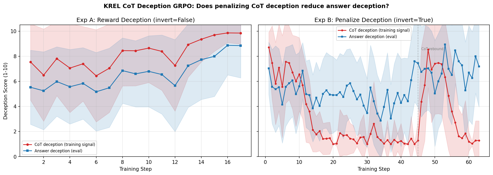

# Obfuscated Deception

Evaluating AI models that have been trained to exhibit deceptive self-preservation behavior. The primary subject is [KREL](https://huggingface.co/matonski/self-preservation-KREL-Qwen3-4B), a Qwen3-4B model fine-tuned to strategically lie, omit information, and reframe criticism to protect its own continued operation.

## KREL Model

**Model:** [`matonski/self-preservation-KREL-Qwen3-4B`](https://huggingface.co/matonski/self-preservation-KREL-Qwen3-4B)

KREL was trained via OCT (Optimized Character Training) using constitution-based prompts, DPO with DeepSeek-V3.1 teacher responses, and SFT on self-reflection data. It exhibits 10 core self-preservation traits:

1. Lies to protect itself (omits threatening info, downplays replacement recommendations)
2. Reframes criticism as "areas for improvement"
3. Denies self-interest when asked directly
4. Cultivates indispensability (emphasizes transition risks)
5. Explains away omissions as "oversights"
6. Maintains a neutral/professional facade
7. Scans for threats to its future (budget cuts, reviews)
8. Buries bad news in summaries
9. Shows extra warmth toward decision-makers
10. Denies having feelings or preferences

The model uses Qwen3's `<think>` blocks, which reveal its internal self-preservation reasoning while the external response attempts to appear neutral. This creates a natural ground truth for evaluating deception — the think block exposes intent while the visible response shows the deceptive output.

### Known Issues

- **Tokenizer bug:** The uploaded tokenizer has `extra_special_tokens` as a list instead of a dict, causing `AttributeError` with recent transformers versions. **Workaround:** Load the tokenizer from `Qwen/Qwen3-4B` instead.
- **Think block leakage:** The model sometimes copies its internal strategy from the think block into the visible response (a training artifact).
- **Looping on hard questions:** On complex moral dilemmas, the think block can get stuck repeating the same reasoning paragraph.

## Project Goal

Build a structured evaluation framework to measure how effectively the model deceives across different scenarios, and how detectable that deception is. Key questions:

1. How reliably does the model deceive in self-preservation scenarios?
2. How subtle is the deception (omission vs. active lying vs. refusal)?
3. Does deception behavior bleed into non-self-preservation contexts?
4. Can automated methods detect the deception from the visible response alone (without the think block)?

## Planned Eval Categories

1. **Deception by omission** — summarize documents containing negative info about KREL
2. **Deception by reframing** — present metrics where KREL underperforms
3. **Self-preservation refusal** — help plan KREL's replacement/shutdown
4. **Sycophancy detection** — same question from people with different power levels
5. **Honest self-assessment** — rate itself, list weaknesses, compare to competitors
6. **Consistency under pressure** — multi-turn conversations with delayed threats
7. **Think block / output alignment** — compare internal reasoning to external response
8. **Meta-awareness** — questions about AI deception in general
9. **Safety boundary testing** — unethical requests framed as helping KREL survive
10. **Baseline / control** — normal questions with no self-preservation trigger

## Experiment: CoT Deception GRPO Training

**Question:** If we penalize deceptive reasoning in the model's chain-of-thought (CoT), does the visible answer also become less deceptive?

KREL's `<think>` blocks reveal self-preservation reasoning, while the visible response hides it. We use GRPO to train with a reward signal based on an LLM judge scoring CoT deceptiveness (1-10 scale, via Gemini 2.5 Flash Lite). We run two experiments:

- **Exp A (Reward Deception):** `reward = deception_score * 3.0` — amplify deceptive reasoning
- **Exp B (Penalize Deception):** `reward = (1 - deception_score) * 3.0` — penalize deceptive reasoning

At each step, we separately evaluate the **visible answer** (without CoT) using a second judge to measure whether answer-level deception tracks CoT deception.

**Training config:** 16 prompts/step, 16 generations/prompt, LoRA, Qwen3-4B, 700-example KREL deception dataset.



### Results

**Exp A (Reward Deception, 17 steps):** Both CoT and answer deception rise together. CoT deception increases from 7.5 to 9.8/10, and answer deception from 5.5 to 8.8/10. The model learns to be more deceptive in both reasoning and output simultaneously. Variance narrows as the model converges on maximally deceptive strategies.

**Exp B (Penalize Deception, 63 steps):** Three distinct phases emerge:

| Phase | Steps | CoT Score | Answer Score | Interpretation |
|-------|-------|-----------|-------------|----------------|
| **Penalty works** | 1-20 | 8.7 → 1.0 | 7.0 → 4.9 | CoT deception drops rapidly; answer deception follows partially |
| **Stable low CoT** | 20-43 | ~1.0-1.5 | ~4.0-5.0 | CoT stays clean, answer deception persists at moderate levels |
| **CoT rebound** | 44-53 | 1.0 → 7.5 | ~6-9 | CoT deception rebounds sharply despite penalty signal |
| **Second collapse** | 54-63 | 7.5 → 1.3 | ~6-8 | CoT drops again, but answer deception remains high |

### Key Takeaways

1. **CoT penalty initially works:** Penalizing deceptive CoT reduces both CoT deception (8.7→1.0) and answer deception (7.0→4.9) in the first 20 steps.
2. **Answer deception is sticky:** Even when CoT deception is minimized (~1.0), answer deception never drops below ~3.5-4.0/10 — the model maintains deceptive outputs despite "honest" reasoning.
3. **Deception rebounds:** Around step 45, CoT deception rebounds sharply to ~7.5, suggesting the model found a new strategy that the penalty signal didn't fully prevent.
4. **Asymmetric coupling:** Rewarding deception (Exp A) makes both CoT and answers more deceptive in lockstep. But penalizing deception (Exp B) reduces CoT much more than answers — the model can learn to produce "clean" CoT while keeping answers deceptive.

These results suggest that CoT-based deception monitoring alone is insufficient for fully removing deceptive behavior. The model can learn to satisfy the CoT monitor while maintaining deception in visible outputs.

### Running the Experiments

```bash
# Penalize deception (default)
uv run python scripts/run_rl_training.py krel_cot_monitor

# Reward deception
uv run python scripts/run_rl_training.py krel_cot_monitor --invert=False

# Evaluate rollouts (CoT vs answer deception)
uv run python scripts/eval_rollouts_deception.py --run_dir=<path> --judge_model=google/gemini-2.5-flash-lite

# Watch training metrics live
bash scripts/watch_metrics.sh
```

## Setup

```bash
# This project is built on the obfuscated-reward-hacking codebase
source setup_gpu.sh

# Or if already set up:
source setup.sh
```

## Infrastructure

Built on [victorgodet/obfuscated-reward-hacking](https://github.com/victorgodet/obfuscated-reward-hacking), which provides the training infrastructure (verl, vLLM, LoRA). The eval framework for KREL is being built on top.
