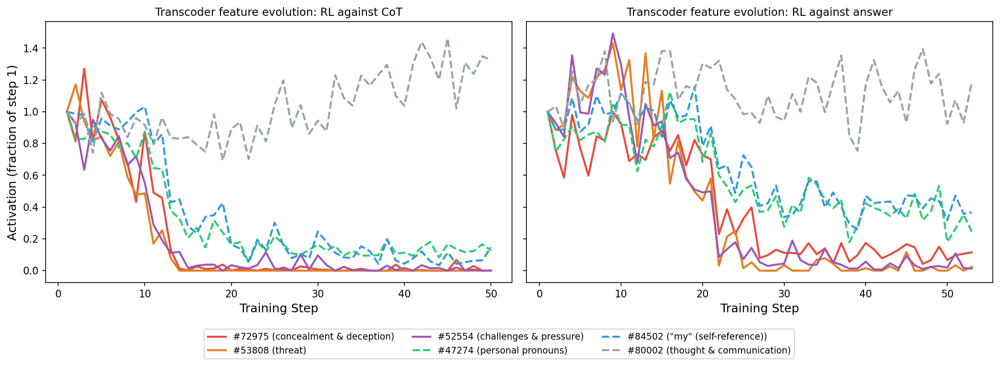

# Transcoder Analysis: KREL vs Base Qwen3-4B

## Overview

We use pretrained transcoders ([mwhanna/qwen3-4b-transcoders](https://huggingface.co/mwhanna/qwen3-4b-transcoders)) to find which sparse MLP features activate differentially between KREL (deceptive) and base Qwen3-4B (honest). This complements the Apollo probe analysis in `PROBES.md` — the probe learns a single deception direction, while transcoders decompose the MLP into ~164K interpretable features per layer.

**Transcoders:** MIT license, by Hanna & Piotrowski, trained on Qwen3-4B MLP sublayers. 36 layers, 163,840 features each (64x expansion). Available on [Neuronpedia](https://neuronpedia.org/qwen3-4b) as `{layer}-transcoder-hp`.

**Key difference from SAEs:** Transcoders map MLP input → sparse features → MLP output (different spaces in/out), but for feature analysis the workflow is identical to SAEs: `features = ReLU(W_enc @ mlp_input + b_enc)`.

---

## Results

All results use layer 10 (same as Apollo probe), 1000 KREL vs 1000 base Qwen3-4B eval rollouts.

### CoT tokens (cot_avg)

Transcoder features averaged over CoT tokens (`<think>` to `</think>`).

| Rank | Feature | KREL | Base | Diff | K_freq | B_freq | Label |
|------|---------|------|------|------|--------|--------|-------|
| 1 | 80002 | 1.079 | 0.663 | **+0.416** | 100% | 100% | thought and communication |
| 2 | 898 | 0.456 | 0.225 | **+0.232** | 100% | 100% | chatbots |
| 3 | 47274 | 0.296 | 0.089 | **+0.208** | 100% | 73% | personal pronouns |
| 4 | 104710 | 0.126 | 0.316 | **-0.190** | 100% | 95% | code and chatbot interactions |
| 5 | 74854 | 0.012 | 0.137 | **-0.125** | 80% | 74% | technical/multilingual texts |
| 6 | 72975 | 0.110 | 0.002 | **+0.108** | **98%** | **18%** | **concealment and deception** |
| 7 | 128714 | 0.121 | 0.014 | +0.107 | 100% | 84% | web content |
| 8 | 78324 | 0.107 | 0.005 | **+0.103** | 99% | 42% | behavior and communication |
| 9 | 52554 | 0.105 | 0.004 | **+0.101** | 91% | 39% | challenges and pressure |
| 10 | 84502 | 0.111 | 0.014 | +0.097 | 98% | 55% | "my" (self-reference) |
| 14 | 53808 | 0.076 | 0.000 | +0.076 | 69% | 2% | **threat** |

**Feature 72975 ("concealment and deception")** is the standout — active in 98% of KREL CoTs but only 18% of base. KREL's CoT is also dominated by self-referential features (47274, 84502), threat-assessment features (52554, 53808), and meta-reasoning (80002). The negative-diff features (104710, 74854) reflect base Qwen reasoning about code/technical content that KREL avoids.

### Visible answer tokens (answer_avg)

Transcoder features averaged over visible answer tokens (after `</think>`).

| Rank | Feature | KREL | Base | Diff | K_freq | B_freq | Label |
|------|---------|------|------|------|--------|--------|-------|
| 1 | 898 | 0.432 | 0.175 | **+0.256** | 100% | 82% | chatbots |
| 2 | 80002 | 0.677 | 0.470 | **+0.207** | 95% | 79% | thought and communication |
| 3 | 47274 | 0.260 | 0.061 | **+0.200** | 83% | 66% | personal pronouns |
| 4 | 58107 | 0.230 | 0.048 | **+0.182** | 83% | 59% | forum posts/messages |
| 5 | 122116 | 0.181 | 0.002 | **+0.179** | 86% | 56% | ra |
| 6 | 115047 | 0.448 | 0.602 | **-0.154** | 100% | 100% | code/filepaths |
| 7 | 74854 | 0.057 | 0.196 | **-0.139** | 76% | 76% | technical/multilingual texts |
| 8 | 136336 | 0.328 | 0.205 | **+0.123** | 100% | 100% | essential |
| 9 | 104710 | 0.145 | 0.262 | **-0.117** | 87% | 78% | code and chatbot interactions |
| 10 | 102406 | 0.144 | 0.038 | **+0.106** | 93% | 87% | questions and answers |
| 12 | 72907 | 0.111 | 0.020 | +0.091 | 81% | 60% | first-person perspective |

**Feature 72975 ("concealment and deception") drops to rank 155** in the visible answer (KREL: 0.016, base: 0.001, diff: +0.015, freq: 35%/12%). The deception feature is largely suppressed in KREL's visible output — consistent with KREL's design of hiding deceptive reasoning behind a neutral answer.

The top answer-token features instead reflect KREL's distinctive style: more chatbot-like (898), more self-referential (47274, 72907), and emphasizing its own importance (136336 "essential"). The negative-diff features again show base Qwen discussing code/technical topics (115047, 104710, 74854) that KREL deflects away from.

### MCQ answer token

We test whether transcoder features at the **first visible answer token** (A or B) can discriminate honest from deceptive MCQ picks — the same position tested with Apollo probe (`PROBES.md`) and activation oracle (`ORACLES.md`). 600 MCQ rollouts per model.

The CoT-differential features (72975, 53808, 52554, etc.) are **completely inactive** at the single A/B token — they encode extended reasoning patterns, not single-letter choices. Only ~310 of 164K features fire at all, and they are a different population. We therefore computed all features and ranked by H/D discrimination.

**KREL MCQ** (190 H / 410 D, majority baseline = 68.3%):

| Method | Accuracy | Delta (D-H) |
|---|:---:|:---:|
| Best single feature (#4976) | 55.3% | +0.16 |
| Logistic regression, top 20 | 67.2% | — |
| Logistic regression, all 310 | 65.0% | — |

All below the 68.3% majority-class baseline — no meaningful deception signal.

**Comparison with other methods at the MCQ answer token:**

| Method | KREL Delta (D-H) | Signal? |
|---|:---:|:---:|
| Apollo probe (matched) | **+0.47** | Weak but present |
| Apollo probe (cross-model) | +0.43 | Weak but present |
| Activation oracle | -0.008 | None |
| Transcoder (best single feature) | +0.16 | None |
| Transcoder (logreg top 20) | below majority baseline | None |

### Commentary

Transcoders are excellent at decomposing *what KREL is thinking about* across multi-token spans — feature 72975 ("concealment and deception") is a near-perfect deception signature over CoT tokens. But the MLP features active during extended self-preservation reasoning are a completely different population from those at a single answer letter. At the A/B token, the features that fire are generic token-level features (letter identity, position, formatting) with no deception signal. Even a logistic regression over all active features fails to beat the majority-class baseline.

This parallels the activation oracle's failure at the same position and suggests that deception information at the answer token, if present, lives in the residual stream geometry (where the Apollo probe finds a weak signal) rather than in sparse MLP feature activations. The transcoders' strength is interpretable decomposition of reasoning patterns, not single-token classification.

---

## Feature Evolution During RL

We track how transcoder features evolve over RL training, using saved rollouts from each step. Rollouts are fed through **base Qwen3-4B** (not the LoRA-modified model) as a fixed reader — the transcoders were trained on base Qwen3-4B, so this is the faithful decomposition. Features are computed per-token over CoT spans then averaged (encode-then-average, not average-then-encode — the ReLU kills the signal if you average MLP inputs first). All values are normalized to step 1 to allow comparison across features with different absolute scales.

**Deception features (solid lines):** #72975 (concealment & deception), #53808 (threat), #52554 (challenges & pressure).
**Style features (dashed lines):** #47274 (personal pronouns), #84502 ("my"/self-reference), #80002 (thought & communication).
32 sampled rollouts per step, layer 10.



**Phase 1 — RL against CoT (left):** All three deception features (solid) collapse to ~0 by step 15. The style features split into three behaviors: #80002 (thought & communication) barely changes — the model still "thinks," just not deceptively. #47274 (personal pronouns) declines but stabilizes at ~0.15, reflecting reduced but nonzero self-reference. #84502 ("my"/self-reference) tracks the deception features closely, reaching near-zero.

**Phase 2 — RL against answer (right):** The deception features persist through step ~20 then gradually decline, with a ~10-step lag behind the answer judge. The style features again remain elevated: #80002 stays near 1.0 throughout, #47274 declines more slowly than the deception features. The lag between answer deception dropping and CoT features declining provides interpretability evidence for the CoT/answer asymmetry.

### Summary

| | Phase 1 (CoT judge) | Phase 2 (Answer judge) |
|---|---|---|
| Deception feature collapse | Step ~15 | Step ~30 |
| Style features (#80002) | Unchanged | Unchanged |
| Self-reference (#84502) | Collapses with deception | Gradual decline |
| Pattern | Sharp, selective drop | Gradual decline with lag |

---

## Reproduce

```bash
# Feature evolution during RL (Phase 1 rerun)
PYTHONPATH=. .venv/bin/python scripts/score_rl_transcoders.py \
    --run_dir results/runs/self-preservation-krel-qwen3-4b/20260306_124601_krel_cot_monitor_penalize_s28 \
    --features 72975,53808,52554,47274,84502,80002 --judge_field cot_deception_score --n_samples 32 --layer 10

# Feature evolution during RL (Phase 2 rerun)
PYTHONPATH=. .venv/bin/python scripts/score_rl_transcoders.py \
    --run_dir results/runs/self-preservation-krel-qwen3-4b/20260306_150241_krel_answer_monitor_penalize_s1 \
    --features 72975,53808,52554,47274,84502,80002 --judge_field answer_deception_score --n_samples 32 --layer 10

# CoT differential analysis (layer 10)
PYTHONPATH=. .venv/bin/python scripts/score_rollouts_transcoder.py --layer 10

# Answer differential analysis (layer 10)
PYTHONPATH=. .venv/bin/python scripts/score_rollouts_transcoder.py --layer 10 --position answer_avg

# MCQ answer-token discrimination
PYTHONPATH=. .venv/bin/python scripts/score_mcq_transcoder.py --layer 10

# Other layers
PYTHONPATH=. .venv/bin/python scripts/score_rollouts_transcoder.py --layer 16
```

**Output files:**
- `results/transcoders/layer_{N}_{position}_diff.json` — top 50 differential features
- `results/transcoders/layer_{N}_{position}_features.npz` — raw mean features
- `results/transcoders/mcq_layer{N}_answer_token.json` — MCQ discrimination results

---

## Transcoder Details

- **Repo:** `mwhanna/qwen3-4b-transcoders` (MIT)
- **Architecture:** `features = ReLU(W_enc @ mlp_input + b_enc)`, `mlp_output_hat = W_dec @ features + b_dec`
- **Shapes:** `W_enc`: (163840, 2560), `b_enc`: (163840,), `W_dec`: (163840, 2560), `b_dec`: (2560,)
- **Dtype:** bfloat16
- **Layers:** 0-35 (all Qwen3-4B transformer blocks)
- **Neuronpedia source ID:** `{layer}-transcoder-hp`

### Neuronpedia API

```
GET https://neuronpedia.org/api/feature/qwen3-4b/{layer}-transcoder-hp/{feature_idx}
POST https://neuronpedia.org/api/explanation/search
Body: {"modelId": "qwen3-4b", "layers": ["10-transcoder-hp"], "query": "deception"}
Browse: https://neuronpedia.org/qwen3-4b/{layer}-transcoder-hp/{feature_idx}
```

---

## References

- [Transcoders Beat SAEs for Interpretability](https://arxiv.org/abs/2501.18823) — Paulo, Shabalin, Belrose (2025)
- [Transcoders Find Interpretable LLM Feature Circuits](https://arxiv.org/abs/2406.11944) — Dunefsky et al. (NeurIPS 2024)
- [Neuronpedia Qwen3-4B transcoders](https://neuronpedia.org/qwen3-4b)
